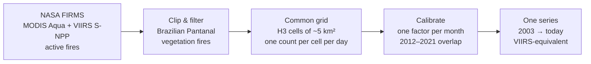
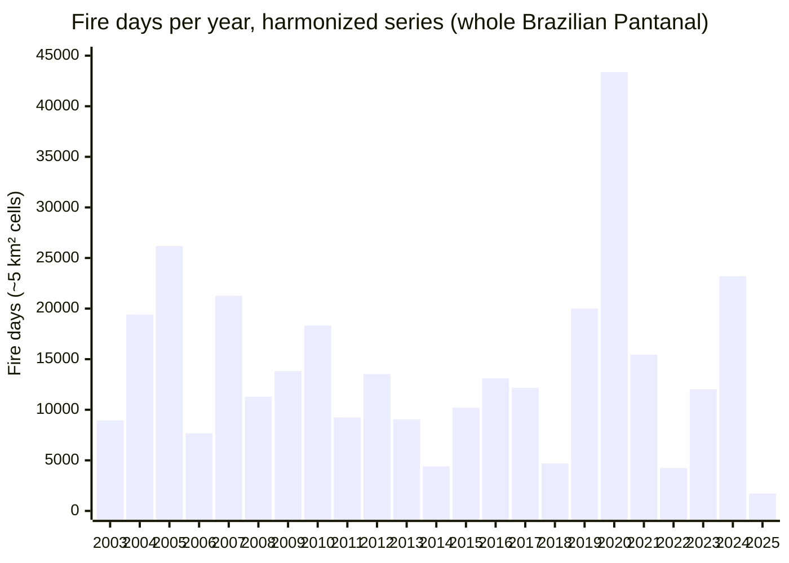
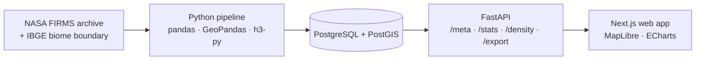

# brasa

### The fire history of the Brazilian Pantanal, in one click.

**NASA Space Apps Challenge 2026** · Challenge 15: _Harmonization of MODIS and VIIRS Hot Spots_

|     | Repository                                             | What's inside                                                                                          |
| --- | ------------------------------------------------------ | ------------------------------------------------------------------------------------------------------ |
| 🗺️  | **[front](https://github.com/Brasa-Space-Apps/front)** | The web app: map, area drawing and the fire-history dashboard (Next.js, MapLibre, ECharts)             |
| 🔥  | **[back](https://github.com/Brasa-Space-Apps/back)**   | The data pipeline, the harmonization method and its validation, and the API (Python, PostGIS, FastAPI) |

**Live API:** [back-mrhi.onrender.com/docs](https://back-mrhi.onrender.com/docs) · **Demo:** [ADD DEMO URL]

---

## Why this matters

The Pantanal is the largest tropical wetland on Earth, and it burns. In 2020 it went through the worst fire year of the last two decades; 2024 was among the worst again.

NASA satellites have watched every one of those fires since the early 2000s. But the record is split in two:

- **MODIS** (Aqua satellite) has been detecting fires since 2002, with 1 km pixels.
- **VIIRS** (Suomi NPP satellite) arrived in 2012, with 375 m pixels, and sees far more, smaller fires.

Put the two side by side and fire seems to **jump overnight in 2012**, only because the sensor changed. Anyone asking _"is this year worse than usual for my area?"_ is comparing apples and oranges.

**Brasa fixes the record, then puts it one click away.**

## What Brasa does

1. **Draw an area** on the map of the Brazilian Pantanal: a polygon, a rectangle, or the whole biome.
2. **Pick a period**, anywhere from January 2003 to the latest data.
3. **Get its fire history**, as one consistent series:
   - fire days in the period, the worst year and the usual peak month;
   - a **year × month calendar** that shows the fire season and the exceptional years at a glance;
   - how the **latest month compares with the same month in every past year** (times the median, and its percentile);
   - a **density map** of where fire concentrates inside the area;
   - a **CSV of the original NASA detections**, each with the conversion factor applied to it, so anyone can redo the numbers.

Available in English and Portuguese, with light and dark themes and colour-blind-safe palettes. No login, nothing to install.

## How we joined two satellites into one series

- **Same yardstick for both sensors.** Instead of counting detections, we ask _"did this ~5 km² hexagon have fire on this day?"_. A big fire that shows up as dozens of VIIRS pixels and a handful of MODIS pixels counts once for both. That alone shrinks the VIIRS/MODIS gap in 2020 from **7.2×** to **2.7×**.
- **One reference satellite per sensor.** Aqua and Suomi NPP fly over the Pantanal minutes apart in the early afternoon. Other satellites are left out on purpose, so none of them can add a false step to the record.
- **A conversion factor for every month.** During 2012–2021 both sensors were flying. For each calendar month we measure how many VIIRS fire days correspond to one MODIS fire day. The factors go from **2.6 in August** (big dry-season fires that both sensors see) to **4.7 in February** (small wet-season fires that mostly only VIIRS catches).
- **Then switch.** Before 2012, MODIS fire days are converted with the factor of their month; from 2012 on, real VIIRS observations are used.

The result: **231,014 harmonized cell-days**, from 2003 to 2025, in a single unit: _fire days per ~5 km² area_.

## Does it work?

We hid two years from the calibration, predicted VIIRS from MODIS alone, and compared with what VIIRS actually saw.

| Test                                                                | Result                                     |
| ------------------------------------------------------------------- | ------------------------------------------ |
| 2019, predicted vs observed                                         | **+12.5%**                                 |
| 2020, the worst year of the series, predicted vs observed           | **−4.2%**                                  |
| Month-by-month correlation in the test years                        | **≥ 0.99**, peak month right in both years |
| Jump between 2011 and 2012                                          | **None**                                   |
| Year ranking vs INPE's reference satellite (BDQueimadas, 2003–2025) | **Spearman 0.98**, same five worst years   |

We compared four conversion methods on the same test and kept the one with the lowest average error that is also the simplest to explain. The full validation, including where the method struggles (very large fire years, very small areas), is in the [back-end repository](https://github.com/Brasa-Space-Apps/back).

### Two decades of fire in the Brazilian Pantanal

The five worst years: **2020 > 2005 > 2024 > 2007 > 2019**. Two of them were seen only by MODIS, three by VIIRS, and they now sit on the same scale. 2025 covers the data loaded so far.

## Under the hood

The science runs **once, offline**. The API clips the drawn area to the Pantanal, covers it with hexagons and sums pre-computed values, so every click is a quick lookup. The method, the API contract and how to run everything locally are documented in each repository.

## Data

- **[NASA FIRMS](https://firms.modaps.eosdis.nasa.gov/)**: MODIS Collection 6.1 (Aqua) and VIIRS 375 m (Suomi NPP) active fire archives.
- **IBGE**: Brazilian biome boundaries, 2019 (1:250,000).
- **INPE / Programa Queimadas**: annual hotspots of the reference satellite, used only to cross-check the year ranking.
- **[H3](https://h3geo.org/)**: hexagonal spatial index. Basemap by [OpenFreeMap](https://openfreemap.org/), © OpenStreetMap contributors.

## What's next

- Daily updates from the FIRMS near-real-time feed.
- Carrying the series forward with NOAA-20, calibrated against Suomi NPP with the same method.
- From fire days to burned area.
- The whole Pantanal, across the Bolivian and Paraguayan borders.

## Team

[ADD TEAM NAME] · NASA Space Apps Challenge 2026 · [ADD LOCAL EVENT]

- [Name] — [role]
- [Name] — [role]
- [Name] — [role]
